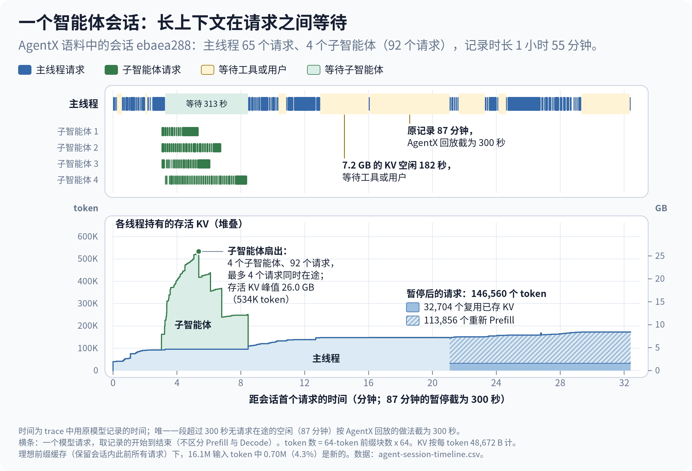
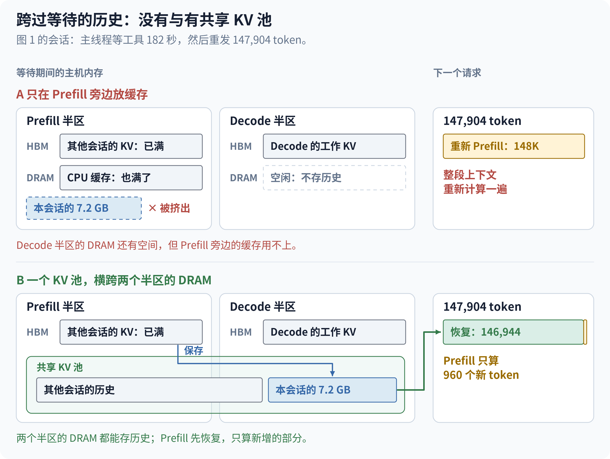
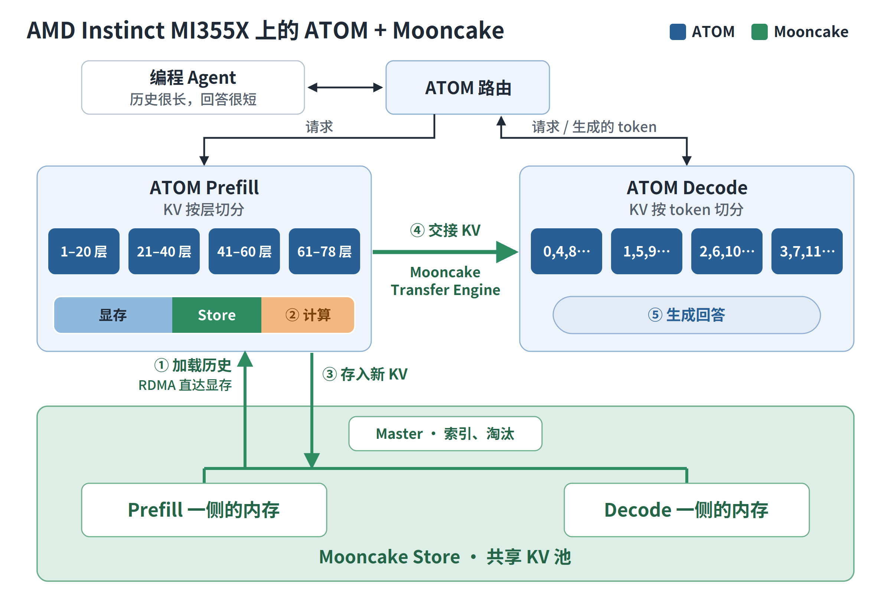
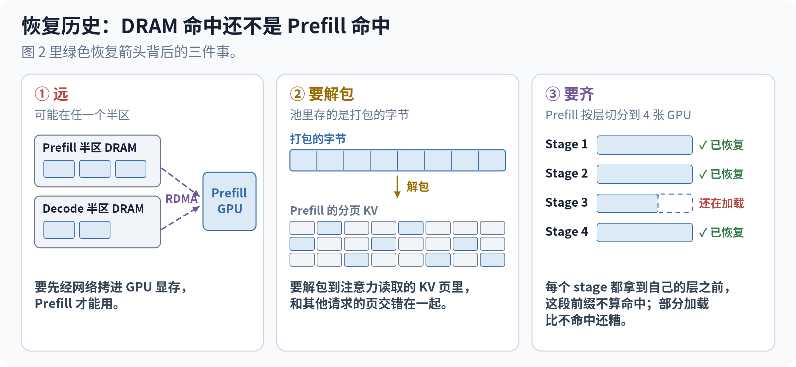
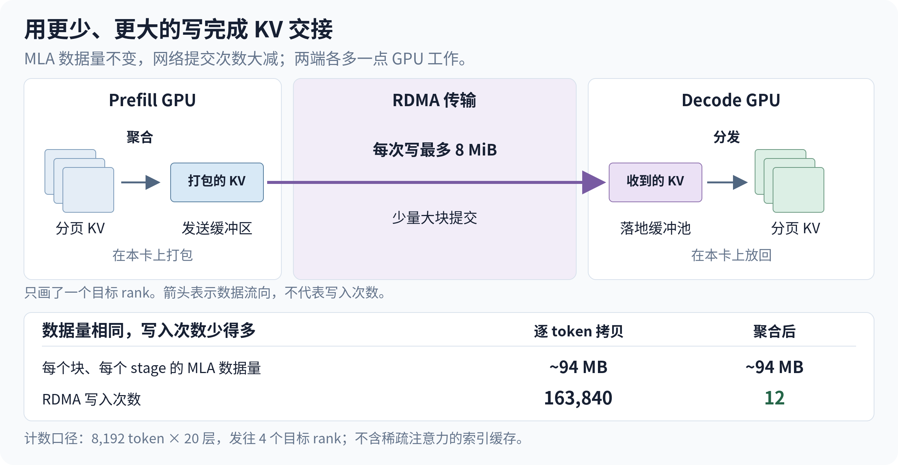
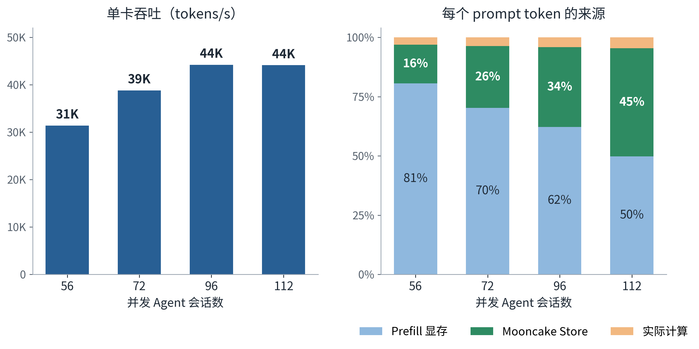
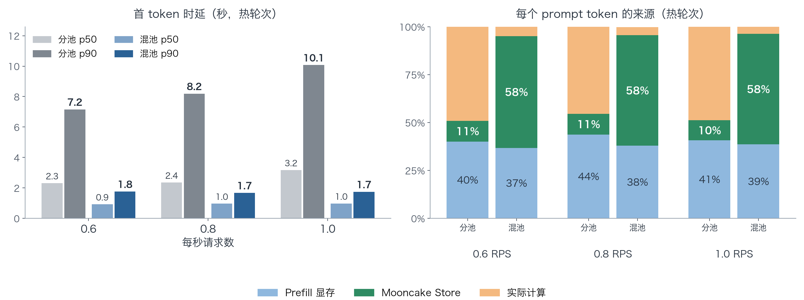
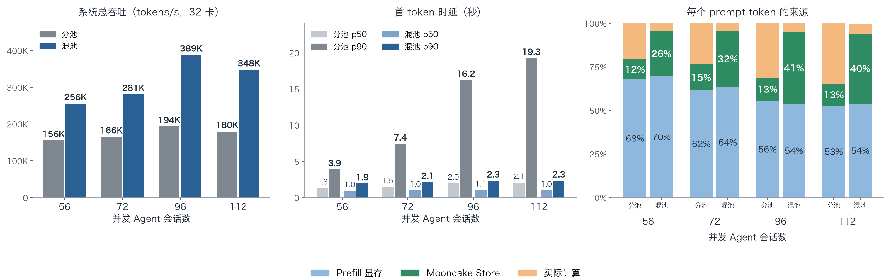

## 引言

编程 Agent 很少提新问题，而是把同一段长对话反复发回来，只在末尾添上几句。随着 Agent 编程成为日常工作，推理服务面对的是一场场很长的会话：Agent 停下来调用工具，回来时希望服务端还留着它的对话历史。SemiAnalysis 现在用 [InferenceX AgentX](https://github.com/SemiAnalysisAI/agentx-harness) 衡量的正是这类负载。

我们把 Prefill 和 Decode 放在不同的 GPU 上，让长 Prefill 不再拖慢正在生成的 Agent。这样做有一个容易被忽略的副作用：主机内存也随之被切成两半，Decode 那一半几乎闲置。**Mooncake Store 把两半内存重新汇成一个 KV 池。** 有了它，ATOM 在一台 8 卡 AMD Instinct MI355X 服务器上同时承载约一百个 Agent 会话，单卡吞吐约 44K tokens/s，95% 以上的 prompt token 来自复用。在 NeuroSpark AI 的四台 MI350X 服务器上，一个共享池的吞吐最高约为每台服务器各自分池的两倍。

## 近看一个 Agent 会话

图 1：公开 AgentX trace 中的一个会话：请求与等待（上），各线程持有的 KV（下）。

AgentX 把录制好的 Claude Code 会话回放到真实的服务上。图 1 跟踪其中一个会话：公开语料 [`cc-traces-weka-062126`](https://huggingface.co/datasets/semianalysisai/cc-traces-weka-062126) 中的 `ebaea288`，选它是因为它的主线程请求数（65 个）正好是语料的中位数。在将近两个小时里，主线程的上下文从 40K 涨到 173K token，中途 Agent 还并行派出了四个子 Agent。图中时间按原模型录制时的记录绘制，唯一一段 87 分钟的长暂停按 AgentX 回放的上限画成 300 秒。

图里有三件事，决定了服务端要怎样对待 KV。

**历史几乎全部可复用。** 每个请求都把同一段对话重发一遍，只在末尾添一点。全语料中，请求输入的中位数是 142K token，若前缀缓存完美，只有 **1.7K** 需要 Prefill。一轮调用是算 1.7K 还是算 142K，只取决于一件事：服务端是否还以 KV 的形式留着这段历史。有些轮次任何缓存都救不了：图 1 中长暂停之后，下一个 prompt 只有开头 32,704 个 token 与之前发过的一致，其余部分要重新 Prefill（斜线部分）。

**历史很重。** GLM-5.3 用 FP8 存 KV 时每个 token 占 48,672 字节，十万 token 的对话约 5 GB。

**历史大部分时间在等待。** 上半图中的浅黄和浅绿色块，是主线程没有请求在跑、在等工具、用户或子 Agent 的时间。图 1 中标出的那次 182 秒等待里，7.2 GB 的 KV 无事可做，但下一轮需要它的全部。四个子 Agent 同时运行时，各自积累自己的上下文，这个会话持有的 KV 一下涨到 26 GB。所以服务端要留住的是每个存活会话的历史，而不只是此刻正在跑的请求。

## 为什么显存不够，P/D 分离又让它更难

图 2：图 1 中那次 182 秒等待前后的历史，没有（A）与有（B）共享 KV 池；示意图。

图 1 中那次 182 秒的等待结束后，主线程发来 147,904 个 token，其中 146,944 个之前发过。历史如果熬过了这次等待，Prefill 只需算 960 个 token；如果没有，就要全部重算（图 2 的 A 栏）。

一个会话很好装，所有存活会话一起就装不下了。按我们的估算，每个存活会话持有约 10 GiB 之后还会被复用的历史（主线程加上正在运行的子 Agent），约一百个会话就需要约 1 TiB。四张 Prefill GPU 放下模型权重后，留给 KV 的只有约 0.4 TiB。负载一高，其他会话的 KV 把这块空间占满，等待中的历史被淘汰，下一轮只能重新 Prefill。

主机内存有这个容量，但 P/D 分离把它切开了。服务器的每一半有自己的 NUMA 节点，Prefill 和 Decode 各占一个。挂在 Prefill 上的 CPU 缓存只能用 Prefill 这一半；Decode 那一半有同样多的内存，却几乎不存历史，因为 Decode 的工作 KV 都在显存里。容量是有的，只是在分离线的另一侧。

**所以我们把两半内存汇成一个 KV 池，Prefill 可以往里存、从里取**（B 栏）。等待期间历史存进池里，下一个请求把它取回，只算新增的 token。这又带来两个新问题：内存里命中还不等于 Prefill 命中，历史要按 Prefill 的布局送到 Prefill GPU 上，请求才能开始；而每个请求的 KV 还要从 Prefill 传到 Decode，才能生成第一个 token。我们定了三个目标：

- 留住远超显存容量的 Agent 历史。
- 让池中的命中及时、安全地变成 Prefill 的命中。
- Prefill 产出 KV 有多快，交给 Decode 就有多快。

## ATOM + Mooncake：两条 KV 通路

图 3：AMD Instinct MI355X 上的 ATOM、Mooncake Store 与 Mooncake Transfer Engine。

**ATOM** 是 AMD 面向 Instinct GPU 的开源推理引擎，基于 ROCm 和 AITER 算子库构建。在这台服务器上，ATOM 在一个 NUMA 节点的四张 GPU 上运行一个 Prefill 实例，在另外四张上运行一个 Decode 实例，前面是 ATOM 的路由。Prefill 按层切分模型：每张 GPU 跑约四分之一的层，是流水线中的一个 stage。Decode 按 token 切分每条序列：每张 GPU 每隔四个 token 存一个，但存所有层。

一轮调用到来时，Prefill 复用显存里仍在的最长前缀，超出的部分从 **Mooncake Store** 经 RDMA 直接加载进显存；它只计算两级缓存都没有的 token，并把新 KV 存进 Store，留给这个会话的下一轮。随后路由把请求交给 Decode，**Mooncake Transfer Engine** 把它的 KV 从 Prefill GPU 送到 Decode GPU，由 Decode 生成回答。

两个 Mooncake 组件负责的 KV 生命周期不同。Transfer Engine 搬的是请求眼下就要用的 KV；Mooncake Store 存的是会话以后还要用的 KV，产生它的请求结束后依然保留，Decode 也从不读取它。**哪些 KV 可以复用、何时可以安全使用，由 ATOM 决定；KV 存放在哪里、怎样搬运，由 Mooncake 负责。**

Mooncake Store 把提供内存的服务和使用内存的客户端分开，正适合 P/D 分离部署。我们在两个 NUMA 节点上各运行一个 Store 服务，每个提供 768 GiB 内存；一个 Mooncake Master 记录每个对象存放在哪里，并在池子用到 90% 时淘汰最久未使用的对象。只有 Prefill GPU 读写这个池，Decode 一侧的 NUMA 节点却提供了一半的内存。这样得到一个 1.5 TiB 的 KV 池，接近 Prefill GPU 上 KV 空间的四倍，用的还是原本闲置的内存。多机部署也可以用同样的方式扩展：每台新增服务器上的 Store 服务都接入同一个池，KV 池随服务器一起扩大，Prefill GPU 仍像这里一样通过 RDMA 直接读写。

KV 池还离不开大页。池中的内存都要注册给 RDMA 网卡，只要某段内存中有一部分退化成 4 KiB 小页，注册就会失败。在繁忙的主机上，透明大页保证不了这一点，所以我们在 Store 服务启动前预留大页。后文 NeuroSpark 的四台服务器上，在 Store 启动前清缓存并整理内存，用透明大页就够了。

## 从池中命中到第一个 token

容量问题相对好解决。只有四张 Prefill GPU 在请求开始前都拿到自己那一份，池中的命中才能省下计算；而交给 Decode 的速度，也必须跟得上 Prefill。

### 按 stage 对齐的加载：让池中命中变成 Prefill 命中

图 4：从内存命中到 Prefill 命中之间的三件事；示意图。

图 4 拆开了图 2 里那支绿色的恢复箭头。历史**远**：它可能在任一半的内存里，要先经网络拷进显存。历史**要解包**：池里存的是打包的字节，要拆回注意力读取的分页 KV。历史**要齐**：Prefill 按层切分，四个 stage 都拿到自己的层，这段前缀才能用。

所以 ATOM 按 Prefill 的切分方式来存 KV：每个流水线 stage 把自己那几层的 KV 按 256 个 token 切成块，每块存成一个独立的 Store 对象；一个前缀只有四个 stage 都存有的部分才算命中。Mooncake 把同一块的四个对象放进同一个分组，淘汰时整组一起淘汰，不会留下只有部分 stage 能加载的块。块切得小，某一轮改动了历史中间的内容时，改动点之前最后一个 256 token 边界以内的部分仍然全部可以复用。

每张 Prefill GPU 向 Mooncake 注册一块缓冲区，KV 经 RDMA 在这块缓冲区和 Store 内存之间直接传输，打包和拆包都由 GPU 自己完成，路径上没有 CPU 拷贝。需要 Store 数据的请求会等每个 stage 都取齐再开始，其他请求照常运行。

### 用大块写入把 KV 交给 Decode

图 5：Prefill 到 Decode 的 KV 交接：Prefill 上聚合，大块 RDMA 写入，Decode 上分发。

Prefill（流水线并行，PP4）和 Decode（张量并行加 Decode 上下文并行，TP4 + DCP4）的 KV 布局不同：每张 Prefill GPU 存全部 token，但只存自己那几层；每张 Decode GPU 存所有层，但只存四分之一的 token。直接拷贝的话，每个 token 的每一层都要单独写一次。一个 20 层的 stage 上一个 8,192 token 的块，就是 163,840 次各 576 字节的写入，瓶颈于是落在提交写请求本身，而不是网络。

ATOM 的做法是先在 Prefill GPU 上把发往每张 Decode GPU 的 KV 聚合成连续的缓冲区，由 Mooncake Transfer Engine 以最大 8 MiB 的 RDMA 写入送进 Decode GPU 上的接收缓冲区，再由 Decode 分发到自己的 KV 页里。同样一块约 94 MB 的数据，现在只需 **12 次**写入。

这是用 GPU 计算和显存换来少得多的网络操作。聚合和分发都在 GPU 上跑，发送和接收缓冲区占用了本可以存 KV 的显存，而且请求要等分发完成才能交给 Decode。

## 实验结果：会话越多，Mooncake Store 承担的复用越多

图 6：56 到 112 个并发会话下的单卡吞吐，以及每个 prompt token 的来源。

我们在[同一轮 InferenceX sweep](https://github.com/SemiAnalysisAI/InferenceX/pull/4045) 中用 InferenceX AgentX 测试了这套部署，并发 Agent 会话数从 56 到 112，每个负载点跑一小时。这轮 sweep 测的是 GLM-5.2，它与 GLM-5.3 结构相同，每个 token 的 KV 大小也一样。模型使用 MXFP4 权重、FP8 KV cache，并开启多 token 预测（MTP），MTP 的平均接受长度按 InferenceX 的规定固定为统一值。单卡吞吐的口径是所有 prompt token（不论是否命中缓存）与生成 token 之和，均摊到全部八张 GPU 上。

**吞吐。** 单卡吞吐从 56 个会话时的约 31K tokens/s 升到 96 和 112 个会话时的约 **44K**，此时用户生成速度的中位数约为 46 tokens/s。

**prompt token 从哪里来。** 复用率之所以一直很高，是因为显存留不住的部分由 Mooncake Store 补上了。56 个会话时，Prefill 显存提供 81% 的 prompt token，Store 提供 16%。会话越多，显存的比例越低，Store 的比例越高，112 个会话时达到全部 prompt token 的 **46%**。各负载下总复用率都在 95% 以上，接近 trace 本身允许的 96%–97%。

**Store 省下了什么。** 如果 Store 提供的那部分改为计算，112 个会话时 Prefill 要算约一半的 prompt token，而不是 4.6%，计算量约为 **11 倍**；96 个会话时约为 9 倍。这是按实测比例推算的结果，不是关掉 Store 的实测。

**恢复有多快。** 一次典型的恢复要取回 110K–130K token 的历史，每张 Prefill GPU 读回并拆包自己那一份的中位数为 150–220 毫秒。四个 stage 并不同时加载，所以一个请求从第一个 stage 开始到最后一个 stage 完成，平均要等 **0.4–1.2 秒**，负载越高越长。所有实测运行中没有一次加载失败。112 个会话时，Mooncake 每小时在这台服务器内部搬运约 66 TB 的 KV，既有 Store 与 Prefill 之间的读写，也有 Prefill 到 Decode 的交接。

**到哪里为止。** 96 个会话以内，首 token 时延的中位数不超过 2.5 秒。到 112 个会话，单卡吞吐仍保持在约 44K，但服务器已没有余量：Decode 的 KV 显存占用中位数达到 **91%**，请求开始在 Prefill 前排队，首 token 时延的中位数升到约 7 秒。

## 扩展到四台服务器：MI350X 上的 GLM-5.3（NeuroSpark）

NeuroSpark 用 ATOM 和 Mooncake Transfer Engine 在四台 8 卡 AMD Instinct MI350X 服务器上服务 GLM-5.3（MXFP4 权重、FP8 KV cache）。我们在这套部署上加入了 Mooncake Store，做了两组实验，都比较分池和混池（即共享池）：一组用回放的生产流量，另一组用和上文相同的 AgentX 测试，Prefill 和 Decode 的并行方式也与上文相同。

**部署形态。** 32 张卡运行 6 个 Prefill 实例和 2 个 Decode 实例（6P2D），分成两组，每组 3 个 Prefill 加 1 个 Decode，前面是 KV 准入网关。每个 Decode 实例用 TP4 加 Decode 上下文并行（DCP4），通过上文介绍的聚合、大块写入、分发路径接收 KV。AgentX 测试中，每个 Prefill 实例与单机部署一样用 PP4，Store 里每个 token 只存一份。生产流量的对比运行在 NeuroSpark 已上线的 recipe 上，其 Prefill 实例用 TP4：在生产负载下 TP4 Prefill 不是瓶颈，且分池、混池两组都用 TP4，对比只反映池化本身的差别。

**KV 池。** Store 没有自己的网卡，与引擎共用每块网卡。池按 RoCE rail 分成四份，每份有自己的 Mooncake Master，每个 Prefill 实例的 rank *i* 读写第 *i* 份。PP4 Prefill 下，各 stage 的对象因此落在不同的份里，由不同的 Master 分别淘汰；一个前缀仍然只有四个 stage 都存有的部分才算命中。包括 Decode 所在的服务器在内，每台服务器提供 8 个 96 GiB 的 Store 服务：每台 768 GiB，合计约 3 TiB。只有 Prefill 实例读写这个池。

### 生产负载下的分池与混池

图 7：每秒 0.6、0.8 和 1.0 个请求时，分池与混池的首 token 时延（p50 和 p90）和每个 prompt token 的来源（热轮次）。

NeuroSpark 生产环境的 GLM-5.3 流量平均约每秒 0.8 个请求，所以我们以每秒 0.6、0.8 和 1.0 个请求回放由生产流量重建的编程 Agent 会话，每组 20 分钟，请求按生产方式设置（输出最多 32K token，开启推理）。两组使用同一套部署，每台服务器同样提供 768 GiB 的 Store 内存，唯一的区别是是否共享：**分池**时，每台服务器的内存只服务本机的 Prefill 实例；**混池**时，四台服务器的内存组成一个池，所有 Prefill 实例共同读写。每条回放 lane 从会话中途开始，所以第一轮在两组里都是冷 Prefill；统计只覆盖之后的轮次。

**跨服务器时，KV 池要共享才划算。** 混池时，各负载下 Mooncake Store 都提供 **58%** 的 prompt token，KV cache 复用率 **95%–96%**：Prefill 只需实际计算 4%–5% 的 prompt token，首 token 时延的中位数约 1.0 秒，p90 为 1.7–1.8 秒。分池时，Store 只提供约 11%，复用率降到 51%–55%：网关和路由把同一个会话的各轮请求分散到四台服务器上的 6 个 Prefill 实例，下一轮请求通常落在一台没有这段会话历史的服务器上。于是 Prefill 要实际计算约一半的 prompt，首 token 时延的 p90 升到 7–10 秒。这正是前文 NUMA 问题的多机版本：只有一侧够得着的内存，起不了多大作用。

### 32 卡上的 AgentX

图 8：PP4 Prefill 加 DCP4 Decode，56 到 112 个并发会话下，分池与混池的系统总吞吐（全部 32 张卡）、首 token 时延（p50 和 p90）和每个 prompt token 的来源。

我们使用与上文相同的 AgentX 工具和 trace（`cc-traces-weka-062126`），直接运行、不经过 InferenceX，每个负载点跑一次、每次 15 分钟。峰值上下文超过该部署 917,504 token 输入上限的 trace 被跳过（393 条中的 10 条），输出长度固定为 trace 记录的长度。我们报告整个系统的吞吐：所有 prompt token（不论是否命中缓存）与生成 token 之和，按全部 32 张卡每秒计。AgentX 里每个 Agent 线程要等上一个请求完成、并过完 trace 记录的等待时间，才发出下一个请求，所以并发会话数固定时，吞吐跟随会话本身的节奏，而不是 GPU 数量。因此四台服务器的系统总吞吐与上文单台 MI355X 服务器相当（两者每个会话都是 3.1K–4.6K tokens/s），单卡吞吐不能与图 6 直接比较；这套部署用的也是 MI350X，并且不开 MTP。

**吞吐与复用。** 系统总吞吐从 56 个会话时的 **256K tokens/s** 升到 96 个会话时的峰值 **389K**，112 个会话时为 348K；首 token 时延的中位数约 1.0 秒（0.96–1.05 秒），p90 不超过 2.3 秒。各负载下 KV cache 复用率都保持在 **94%–96%**（trace 理论上限约 97%）。与图 6 一样，显存留不住的部分由 Mooncake Store 补上：56 个会话时 Prefill 显存提供 70% 的 prompt token，96 和 112 个会话时降到 54%，Store 的比例则从 26% 升到 **40%–41%**。

**高并发下分池跟不上。** 我们在同一套部署上把 Store 改成分池（每台服务器的 Store 只服务本机的 Prefill 实例），重复了这组测试。系统总吞吐停在 156K–194K tokens/s，混池则是 256K–389K：56 个会话时混池快 1.6 倍，96 和 112 个会话时约快 2 倍。分池时 Store 只提供 12%–15% 的 prompt token，KV cache 复用率随会话数增加从 79% 降到 65%，Prefill 要实际计算 21%–35% 的 prompt token，而混池只需 4%–6%。首 token 时延的 p90 从 3.9 秒升到 19.3 秒，混池则保持在 1.9–2.3 秒。

## 下一步

借助 Mooncake，ATOM 已经能在一台服务器上、也能在四台服务器之间留住 Agent 的历史，但仍有继续推进的空间。

**在更多服务器间共享一个 KV 池**。在四台服务器上，共享一个池已经让高并发时的吞吐比分池高出约一倍。更大的池能让更多会话保持这么高的复用率，代价是更多跨服务器流量和更大的故障域；下一步是在四台以上的部署中实测这一取舍。

**增加 SSD 层**。有些 Agent 会话一停就是好几分钟甚至更久。[Mooncake 的 SSD offloading](https://kvcache.ai/blog/scaling-kv-cache-beyond-memory/) 能以远低于内存的成本保留它们的历史。

**给 Decode 腾出空间**。Decode 把每个运行中请求的 KV 都放在显存里，单机 112 个会话时已接近占满。下一步是给每个 Prefill 实例配更多 Decode GPU，并让每张 Decode GPU 放下更多 KV。

**多节点 RoCE 拥塞控制**。多对一和一对多的 RDMA 流量（跨服务器的 Prefill 到 Decode KV 传输，以及从 Store 恢复 KV）需要生效的拥塞控制（ECN/DCQCN 或 PFC），带宽才能在各张卡之间均匀分配。NeuroSpark 正在其四台服务器的网络上修复这一点，修复后会重新测量 AgentX。

## 致谢

感谢 Mooncake 社区提供 Mooncake Store 与 Transfer Engine，并与我们一起推进这套部署；感谢 SemiAnalysis 提供 AgentX 和 InferenceX；感谢 AMD ATOM、AITER、FlyDSL 与 ROCm 团队提供这项工作所依赖的推理引擎、算子和软件栈。特别感谢：

- AMD：Yajie Zhang、Hattie Wu、Lingpeng Jin、Carlus Huang、Yuechao Guo、Honglie Yi、Lirong Zhang、Peng Sun、Emad Barsoum
- NeuroSpark AI：Runzhe Hao、Calvin Fei、Ivan Shan、Thomas Ning
- Mooncake：待补充

ATOM 的 Mooncake Store 连接器（[ROCm/ATOM#2464](https://github.com/ROCm/ATOM/pull/2464)）和 Prefill 到 Decode 的传输通路（[ROCm/ATOM#2431](https://github.com/ROCm/ATOM/pull/2431)）均已开源。

## 相关链接

- ATOM：<https://github.com/ROCm/ATOM>
- Mooncake 项目：<https://github.com/kvcache-ai/Mooncake>
- AgentX 基准：<https://github.com/SemiAnalysisAI/agentx-harness>
- AgentX trace 语料：<https://huggingface.co/datasets/semianalysisai/cc-traces-weka-062126>
- 这套部署的 InferenceX 结果：<https://github.com/SemiAnalysisAI/InferenceX/pull/4045>

## 附录：测试环境与可复现性（四机 GLM-5.3）

本附录覆盖 NeuroSpark 一节中四机 GLM-5.3 的测量（图 7 和图 8）。

**硬件与系统**（除注明外四台服务器相同）

| 项目 | 值 |
|---|---|
| 服务器 | 4 台，每台 8 张 AMD Instinct MI350X（gfx950，288 GB HBM3E），VBIOS 00165723 |
| CPU、内存 | 2 颗 AMD EPYC 9755（2 个 NUMA 节点），1,511 GiB |
| 操作系统、内核 | Ubuntu 22.04.5 LTS，6.8.0-138-generic；`iommu=pt`，`numa_balancing=0`，THP 为 `madvise`，未预留大页 |
| GPU 驱动、固件 | amdgpu 6.16.13；GPU 固件 CP_MEC 41、RLC 43、SDMA 12、VCN 09.10.B0.09 |
| 主机工具 | AMD SMI 26.5.0，主机 ROCm 7.14.0（其中一台 7.14.1；容器内不使用），Docker 29.8.0（其中一台 29.1.3） |
| RDMA 网卡 | 8 块 Broadcom BCM957608-P1400GDF00（400 Gb/s RoCE v2，MTU 9000），每张 GPU 一块；固件 237.1.148.0（其中一台为 230.2.49.0）；bnxt_en / bnxt_re 237.1.137.0 |
| 拓扑 | 每张 GPU 使用最近的网卡；slot 0 的 GPU 0–3 与 slot 1 的 GPU 5、4、7、6 对应同样四条 rail，所以每个引擎的 rank *i* 在同一条 rail 上。 |

**软件**

| 项目 | 值 |
|---|---|
| 容器镜像 | `rocm/atom-dev:nightly_202610231448-rocm10.0`，`sha256:082403b0dab5ef607d826f431ab636d2c146114d105b5e83b3961a3eadfcfb75`（所有引擎、Store、路由、网关和压测客户端） |
| ATOM | commit `573e9c7de8e3462f24cdc6242970263493e3612b`（0.1.9.dev16） |
| Mooncake Store / Transfer Engine | 0.3.13（git `78566d45`），Master、Store 服务二进制和 Python wheel 来自同一构建 |
| AITER | 0.1.27.dev117（`amd-aiter 0.1.27.dev117+g1e2d557d7`），commit `1e2d557d7877f880e7daf3ac8d5cc45f918f6d9e` |
| ROCm | 10.0.0（镜像内） |
| PyTorch、Triton | PyTorch 2.11.0+rocm10.0.0（git `c9ab2693`），Triton 3.8.0（git `4cff872c`） |
| Python、Transformers | Python 3.12.3，Transformers 5.16.1 |
| 路由 | atomesh 0.2.0 |
| 模型 | `amd/GLM-5.3-Quark-MXFP4-AttnFP8`，revision `4992911b6f4e4d20947573ac7e04ff7d18b32288`（78 层） |
| 测试工具 | AgentX harness 1.0.7，数据集 `semianalysisai/cc-traces-weka-062126` revision `23f152f6f0f9399a85901b89a6458def0ef16729`。未直接使用 InferenceX |

**配置**

| 项目 | 值 |
|---|---|
| 摆放 | 6P2D，分成两组（每组 3 个 Prefill 加 1 个 Decode）；Prefill 不放在本组 Decode 所在的服务器；每个引擎占一个 NUMA 节点的 4 张 GPU |
| Prefill（图 8） | TP1 × PP4，层切分 20/20/20/18，eager，单批最多 8,192 token |
| Prefill（图 7） | TP4，完整 CUDA graph，单批最多 16,384 token |
| Decode（两组相同） | TP4 + DCP4，完整 CUDA graph；开启 ATOM 的聚合 / 落地传输 |
| 通用引擎设置 | FP8 KV cache，block 16，最大长度 1,048,576，最多 256 个序列，显存利用率 0.85，开启前缀缓存，不开 MTP |
| KV 传输 | Mooncake Transfer Engine，RDMA，每个端点一个 QP，每个 rank 绑定最近的网卡 |
| Mooncake Store | 池按 rail 分成四份（4 个 Master；占用 90% 时按 LRU 淘汰，每次 5%）；每台服务器 8 个 96 GiB 的 Store 服务，清缓存和内存整理后用透明大页；每个 Store 服务放在下一条 rail 的网卡上。混池：所有 Prefill 实例使用同样 4 个 Master。分池（图 7 和图 8）：每台服务器运行自己的 4 个 Master，只供本机 Prefill 使用 |
| 路由、网关 | 每组一个路由（感知 Decode，Prefill 之间用 `power_of_two`）；一个 KV 准入网关：每个 Decode 实例 1,000 万 token × 0.9，输入最多 917,504、输出最多 131,072 token，准入等待 30 秒（回放）或 900 秒（AgentX，其 warm-up 会同时启动所有会话） |
| AgentX 设置 | `agentx profile`，并发 56 / 72 / 96 / 112，每个负载 900 秒，每条 lane 3 个 warm-up 请求，`ignore_eos` 加 trace 记录的输出长度，关闭推理，`--max-context-length 917504` |
| 回放设置 | 160 条 lane，泊松到达 0.6 / 0.8 / 1.0 RPS，每组 20 分钟，`max_tokens` 32,000，开启推理，seed 7 |
| 网络 | 所有优先级 PFC 关闭，ECN/CNP 计数为 0，网卡未配置拥塞控制（有损 RoCE） |
| 启动文件 | NeuroSpark 的 ATOM + Mooncake MXFP4 分离部署 recipe，加两处实验改动（Prefill 流水线并行与 Store 环境变量透传、网关接受 `ignore_eos`）以及启动脚本；可按需提供 |
